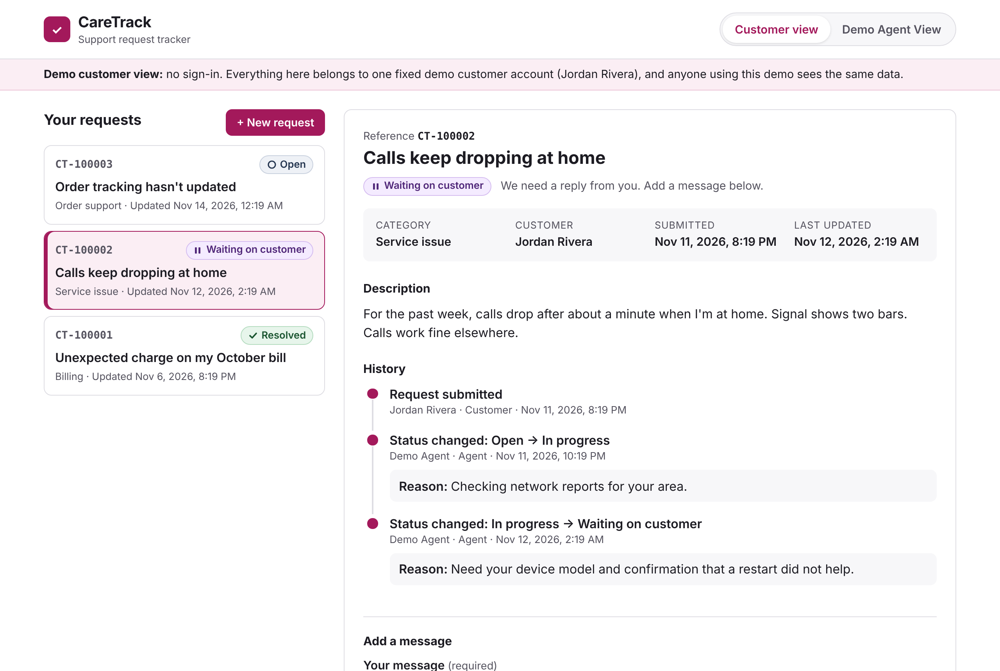
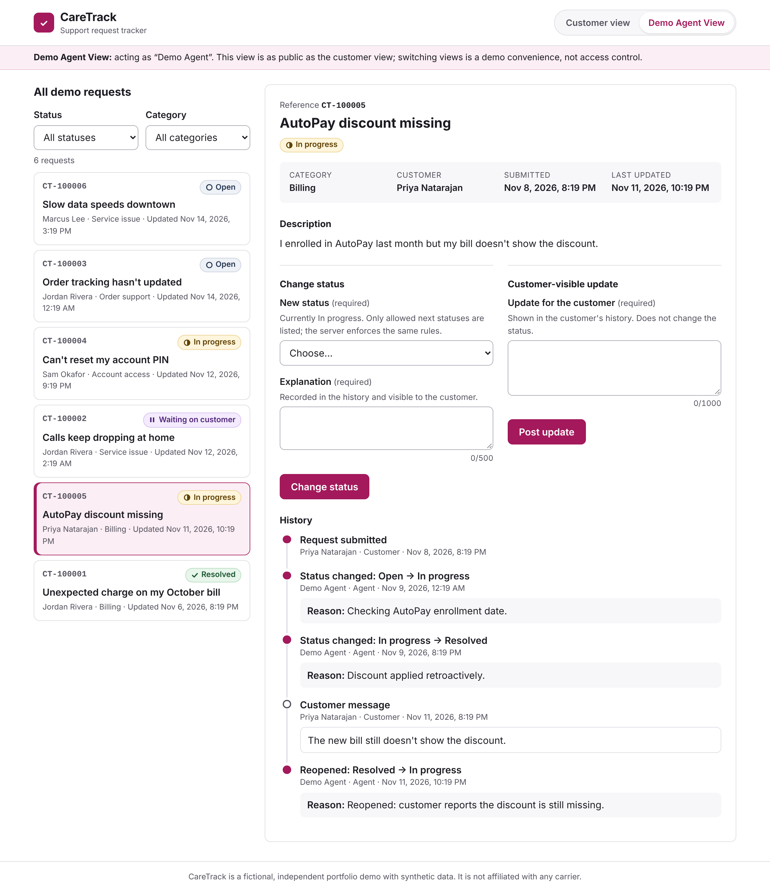
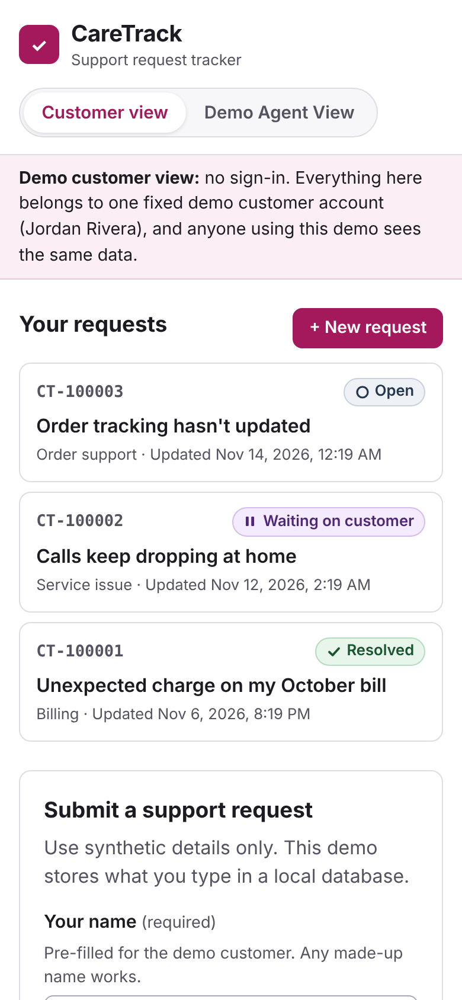

# CareTrack: Customer Support Request Tracker

[](https://github.com/pelzade127/caretrack/actions/workflows/ci.yml)

CareTrack is a small full-stack app for a **fictional** telecom support desk. A customer submits a support request, gets a reference number, and follows its progress. A demo agent works the request: posting customer-visible updates and moving it through a fixed set of statuses, each change explained and recorded in the request's history.

> **Independent portfolio demonstration.** CareTrack is not affiliated with, endorsed by, or based on any real carrier's systems, branding, data, or workflows. Every name, account, and request in it is synthetic. Do not enter real personal information.

| Customer view | Demo Agent View |
| --- | --- |
|  |  |



*About these screenshots:* they show the real React frontend, but they were captured against a temporary stand-in for the API (loaded with the same seed data). The Spring Boot backend couldn't be built in the environment where this project was generated. Retake them against the real backend once it is running (see [Verification status](#verification-status)).

---

## Contents

- [Tech stack and versions](#tech-stack-and-versions)
- [Prerequisites](#prerequisites)
- [Run it](#run-it)
- [Test it](#test-it)
- [Configuration](#configuration)
- [Persistence, seed data and reset](#persistence-seed-data-and-reset)
- [Architecture](#architecture)
- [Status rules](#status-rules)
- [REST API](#rest-api)
- [Security limitations](#security-limitations)
- [Realistic future improvements](#realistic-future-improvements)
- [Verification status](#verification-status)
- [AI assistance disclosure](#ai-assistance-disclosure)

## Tech stack and versions

| Layer | Choice | Version |
| --- | --- | --- |
| Language | Java | 21 (LTS) |
| Framework | Spring Boot (Web, Data JPA, Validation) | 3.5.16 |
| Build | Maven via Maven Wrapper | Wrapper 3.3.4 → Maven 3.9.11 |
| Database | H2 (file-backed; in-memory for tests) | managed by Spring Boot |
| Tests | JUnit 5, Mockito, Spring MockMvc, Hamcrest | via `spring-boot-starter-test` |
| Frontend | React + TypeScript, built with Vite | React 19.3.1, TypeScript 5.9.3, Vite 8.3.7 |
| Runtime for frontend tooling | Node.js | 20.19+ or 22.12+ |

Library versions that aren't listed (Hibernate, H2, Jackson, JUnit, Mockito) come from Spring Boot 3.5.16's dependency management. Run `./mvnw dependency:tree` to see them.

**Why Spring Boot 3.5 rather than 4.x?** 3.5 is the last 3.x line and still receives patch releases. Its APIs (Jackson 2, `spring-boot-starter-web`, the familiar test packages) match most of the tutorials and documentation available today, which matters for a learning project. Moving to 4.x is listed under future improvements.

## Prerequisites

- **JDK 21** (`java -version` should print 21). You don't need Maven installed; `./mvnw` downloads it.
- **Node.js 20.19+ or 22.12+** and npm (`node -v`).
- Internet access the first time you build (Maven Central and the npm registry).

## Run it

Use two terminals.

**1. Backend** (http://localhost:8080):

```bash
cd caretrack/backend
./mvnw spring-boot:run          # Windows: mvnw.cmd spring-boot:run
```

**2. Frontend** (http://localhost:5173):

```bash
cd caretrack/frontend
npm install
npm run dev
```

Open http://localhost:5173. Use the **Customer view / Demo Agent View** switch in the header. The agent view is also reachable directly at http://localhost:5173/#agent.

The Vite dev server forwards every `/api/...` call to port 8080, so the browser only talks to one origin.

**Try the API without the UI:** with the backend running, either

```bash
./scripts/api-demo.sh                     # curl walk-through: create → … → resolve → reopen
```

or open `api-examples.http` in VS Code (REST Client extension) or IntelliJ and click "Send request".

## Test it

GitHub Actions (`.github/workflows/ci.yml`) runs the backend tests and the frontend build on every push to `main` and on every pull request. The badge at the top shows the latest result. To run the same checks locally:

```bash
cd caretrack/backend
./mvnw test                     # all backend unit + integration tests

cd ../frontend
npm run build                   # TypeScript type-check + production build
```

Backend tests:

| Test class | Kind | What it proves |
| --- | --- | --- |
| `entity/RequestStatusTest` | Unit | All 16 (from → to) status pairs: 5 allowed, 11 rejected (including same-status); only RESOLVED → IN_PROGRESS counts as a reopening |
| `service/SupportRequestServiceTest` | Unit (Mockito, fixed `Clock`) | Creation and initial history; status-change history fields; reopening event; rejected changes save nothing; customer messages and agent updates never change status; missing requests |
| `dto/RequestValidationTest` | Unit (Bean Validation) | Required fields, whitespace-only input, trimming, exact length boundaries |
| `controller/RequestApiIntegrationTest` | Integration (MockMvc + H2) | HTTP status codes, error JSON shape, 404/409/400 handling, customer isolation, filters, ordering, and a full create → resolve → reopen flow re-read from the database |
| `seed/DemoDataSeederTest` | Integration | Seeding twice inserts nothing new; seed data includes a recorded reopening |

Tests use the `test` profile (`src/test/resources/application-test.properties`): an in-memory H2 database, schema created fresh, seeding off. They never touch your local data file.

## Configuration

All backend settings are in `backend/src/main/resources/application.properties`.

| Setting | Default | Purpose |
| --- | --- | --- |
| `server.port` | `8080` | API port |
| `CARETRACK_DB_PATH` (env var) | `./data/caretrack` | H2 file location, relative to where you start the backend |
| `caretrack.seed.enabled` | `true` | Insert demo requests at startup |
| `caretrack.cors.allowed-origins` | `http://localhost:5173` | Origins allowed to call `/api/**` directly. Only GET/POST and the `Content-Type` header are allowed. Unused when going through the Vite proxy. |
| `spring.jpa.open-in-view` | `false` | Database access stays inside service transactions |
| `server.error.include-stacktrace` | `never` | Belt-and-braces: no stack traces in any error response |

Frontend: `CARETRACK_API_URL` changes where the Vite proxy sends `/api` (default `http://localhost:8080`). `VITE_API_BASE_URL` makes the browser call a backend directly instead of through the proxy.

## Persistence, seed data and reset

- **Persistence:** H2 in file mode, so data survives restarts. The file is `backend/data/caretrack.mv.db` (git-ignored). Hibernate creates and updates the tables from the entity classes (`ddl-auto=update`).
- **Seed data:** `DemoDataSeeder` inserts six synthetic requests, `CT-100001` to `CT-100006`. Three belong to the demo customer (Jordan Rivera); three belong to other made-up customers and appear only in the agent view. Between them they cover every status, a customer message, an agent update, and a reopened request (`CT-100005`).
- **Idempotent:** each seed request is inserted only if its reference isn't already in the database, so restarting never duplicates it. Seed references contain the digits 0 and 1, which the reference generator never uses, so generated references can't collide with them. Seed timestamps are placed in the recent past relative to the first time the seed runs.
- **Reset to a clean demo:** stop the backend, delete the data folder, start again.

  ```bash
  cd caretrack/backend
  rm -rf data                      # Windows PowerShell: Remove-Item -Recurse -Force data
  ./mvnw spring-boot:run
  ```

- **Start with no demo data:** `./mvnw spring-boot:run -Dspring-boot.run.arguments=--caretrack.seed.enabled=false`

## Architecture

```
caretrack/
├── backend/                          Spring Boot API
│   └── src/main/java/com/caretrack/
│       ├── controller/               HTTP layer: routes, status codes, @Valid
│       │   ├── CustomerRequestController
│       │   └── AgentRequestController
│       ├── service/                  Business rules + transactions
│       │   ├── SupportRequestService       ← start reading here
│       │   ├── ReferenceNumberGenerator
│       │   └── DemoActors                  fixed demo customer/agent identities
│       ├── repository/               Spring Data JPA interface (queries from method names)
│       ├── entity/                   JPA entities + enums (incl. the transition table)
│       ├── dto/                      Request/response records + validation limits
│       ├── exception/                Custom exceptions + GlobalExceptionHandler
│       ├── seed/                     Deterministic, idempotent demo data
│       └── config/                   Clock bean, dev CORS
├── frontend/                         React + TypeScript (Vite)
│   └── src/
│       ├── api.ts                    fetch wrapper; turns error JSON into ApiError
│       ├── customer/  agent/         the two views
│       └── components/               StatusBadge, Timeline, forms, list
├── api-examples.http                 runnable requests
├── scripts/api-demo.sh               curl lifecycle walk-through
├── LEARNING_GUIDE.md
└── docs/screenshots/
```

Each HTTP request flows: **React → `api.ts` → Controller → Service → Repository → H2**, and the response comes back as a DTO. `LEARNING_GUIDE.md` follows one request through every layer.

Design decisions worth knowing:

- **Rules live in Java, not the UI.** `RequestStatus.canTransitionTo` defines the transitions; `SupportRequestService.changeStatus` enforces them before anything is saved. The API returns `allowedNextStatuses` with each request, so the UI shows only valid options without keeping its own copy of the rules.
- **Atomic status changes.** The status update and its history event are saved in one `@Transactional` method through a JPA cascade. Either both are written or neither is.
- **Public IDs vs internal IDs.** URLs use the reference number (`CT-7K3QXM`); the database's numeric ID never leaves the server.
- **Server-side timestamps.** All times come from an injected `java.time.Clock` (UTC, truncated to microseconds to match database precision). Clients can't set them, and tests can freeze them.
- **Predictable ordering.** Lists sort by last update (newest first), then ID. History sorts by time, then ID.
- **Optimistic locking.** A `@Version` column makes two simultaneous edits to one request produce a 409 instead of silently overwriting each other.
- **Privacy-aware logging.** Logs contain references, categories and statuses, never names or message text.

## Status rules

```
           ┌───────────────► WAITING_ON_CUSTOMER
           │                        │
OPEN ──► IN_PROGRESS ◄──────────────┘
           │  ▲
           ▼  │ (reopening: recorded as REOPENED)
         RESOLVED
```

| From | Allowed to |
| --- | --- |
| `OPEN` | `IN_PROGRESS` |
| `IN_PROGRESS` | `WAITING_ON_CUSTOMER`, `RESOLVED` |
| `WAITING_ON_CUSTOMER` | `IN_PROGRESS` |
| `RESOLVED` | `IN_PROGRESS` (history event type `REOPENED`) |

Every other change is rejected with **409 Conflict**, including "changing" to the current status. Every status change needs an explanation (5–500 characters). Each one records the previous status, new status, explanation, timestamp and actor ("Demo Agent"). **Customer messages and agent updates never change the status.**

## REST API

Base URL `http://localhost:8080`. JSON in and out. Enum values are upper-case (`BILLING`, `IN_PROGRESS`).

| Method | Path | Success | Purpose |
| --- | --- | --- | --- |
| POST | `/api/customer/requests` | 201 + `Location` | Create a request for the demo customer |
| GET | `/api/customer/requests` | 200 | List the demo customer's requests |
| GET | `/api/customer/requests/{reference}` | 200 | Details + history (404 if it belongs to another customer) |
| POST | `/api/customer/requests/{reference}/messages` | 201 | Add a customer message |
| GET | `/api/agent/requests?status=&category=` | 200 | List all requests; both filters optional |
| GET | `/api/agent/requests/{reference}` | 200 | Details + history |
| POST | `/api/agent/requests/{reference}/updates` | 201 | Add a customer-visible agent update |
| POST | `/api/agent/requests/{reference}/status-changes` | 201 | Change status (409 if not allowed) |

Categories: `BILLING`, `ACCOUNT_ACCESS`, `SERVICE_ISSUE`, `ORDER_SUPPORT`.

**Create a request**

```bash
curl -i -X POST http://localhost:8080/api/customer/requests \
  -H 'Content-Type: application/json' \
  -d '{"customerName":"Jordan Rivera","category":"BILLING",
       "subject":"Charged twice for one payment",
       "description":"My card was charged twice on the 3rd for a single bill payment."}'
```

```json
{
  "referenceNumber": "CT-7K3QXM",
  "customerName": "Jordan Rivera",
  "category": "BILLING",
  "subject": "Charged twice for one payment",
  "description": "My card was charged twice on the 3rd for a single bill payment.",
  "status": "OPEN",
  "allowedNextStatuses": ["IN_PROGRESS"],
  "createdAt": "2026-11-14T20:15:03.120458Z",
  "updatedAt": "2026-11-14T20:15:03.120458Z",
  "history": [
    { "id": 41, "type": "CREATED", "actorType": "CUSTOMER", "actorName": "Jordan Rivera",
      "message": null, "previousStatus": null, "newStatus": "OPEN",
      "createdAt": "2026-11-14T20:15:03.120458Z" }
  ]
}
```

**Change status**

```bash
curl -X POST http://localhost:8080/api/agent/requests/CT-7K3QXM/status-changes \
  -H 'Content-Type: application/json' \
  -d '{"newStatus":"IN_PROGRESS","explanation":"Reviewing the duplicate charge"}'
```

**Error shape** (same for every error):

```json
{
  "timestamp": "2026-11-14T20:16:44.002Z",
  "status": 409,
  "error": "Conflict",
  "message": "Cannot change status from OPEN to RESOLVED. Allowed next statuses: IN_PROGRESS.",
  "path": "/api/agent/requests/CT-7K3QXM/status-changes",
  "fieldErrors": []
}
```

| Situation | Status | Notes |
| --- | --- | --- |
| Validation failure | 400 | `fieldErrors` lists each field and message |
| Malformed JSON / unknown enum value | 400 | |
| Bad query parameter (`?status=DONE`) | 400 | Message lists allowed values |
| Unknown reference, or another customer's request in the customer API | 404 | |
| Forbidden status transition | 409 | Message lists allowed next statuses |
| Concurrent edit of the same request | 409 | Optimistic locking |
| Unexpected error | 500 | Generic message; details logged server-side only |

**Validation limits** (input is trimmed first; whitespace-only counts as missing):

| Field | Rule |
| --- | --- |
| `customerName` | required, ≤ 80 |
| `category` | required, one of the four values |
| `subject` | required, 5–120 |
| `description` | required, 10–2000 |
| `message` (customer message / agent update) | required, ≤ 1000 |
| `newStatus` | required |
| `explanation` | required, 5–500 |

More examples, including every error case, are in `api-examples.http`.

## Security limitations

This is a demo, and it is deliberately **not** secure:

- **No authentication.** Anyone who can reach the API acts as the one demo customer *and* can call every agent endpoint.
- **The view switch is not authorization.** Both views, and both sets of endpoints, are equally public. Hiding the agent view in the UI would not protect the agent API.
- **"Customer isolation" is a demo rule.** The customer endpoints only return the fixed demo account's requests, but that account is hard-coded, not tied to a logged-in user.
- **No rate limiting, CSRF protection, or audit of who made a change** beyond the fixed "Demo Agent" label.
- **H2 with an empty password** is fine on a laptop and unacceptable anywhere else.
- **The H2 console is off**, stack traces are never returned, and logs avoid names and message text, but the database file itself is not encrypted.

Don't deploy it publicly as-is, and never put real customer data in it.

## Realistic future improvements

1. **Authentication and roles:** Spring Security with a `CUSTOMER` and an `AGENT` role; customers see only their own requests, and only agents can call `/api/agent/**`.
2. **Schema migrations:** replace `ddl-auto=update` with Flyway scripts; switch to PostgreSQL for anything shared.
3. **Pagination** for the list endpoints (Spring Data `Pageable`).
4. **Internal notes:** an agent-only event type that the customer API filters out.
5. **OpenAPI docs:** generate an OpenAPI spec and Swagger UI from the controllers.
6. **Frontend tests:** Vitest + React Testing Library for the forms, plus a Playwright end-to-end test.
7. **Upgrade to Spring Boot 4.x / Jackson 3** once comfortable with 3.5.
8. **Containerize:** a `docker compose` file for the backend, frontend and database.

## Verification status

What has been checked so far (November 2026), and what has not:

- ✅ **Frontend:** `npm run build` (strict TypeScript type-check + Vite production build) passes.
- ✅ **UI:** the frontend was exercised in a headless browser at desktop and phone widths: submit with validation errors, successful create, customer message, filters and empty state, status change, keyboard focus, no horizontal scrolling on mobile, no console errors. **The API behind it was a temporary stand-in** that imitates the documented contract.
- ✅ **Backend:** `./mvnw test` passes in GitHub Actions (Java 21, Ubuntu), first green run on 2026-11-16: [CI run](https://github.com/pelzade127/caretrack/actions/runs/44012002892). It was not run in the original generation environment (Maven Central was blocked there).
- ⏳ **Still to do on a personal machine:** start the backend and frontend together, run `./scripts/api-demo.sh`, retake the screenshots against the real API, and update this section with what you saw.

## AI assistance disclosure

This project was built with substantial help from **Claude**, Anthropic's AI assistant. From requirements I wrote (scope, stack, business rules, testing and documentation expectations), Claude generated the backend and frontend code, the tests, the seed data, this README and `LEARNING_GUIDE.md`.

My role: defining the requirements, reviewing the result, running and verifying it on my machine, and using it to learn Java and Spring Boot. I don't claim to have written this implementation independently. `LEARNING_GUIDE.md` lists changes I plan to make myself; commits after the initial one record my own work.
